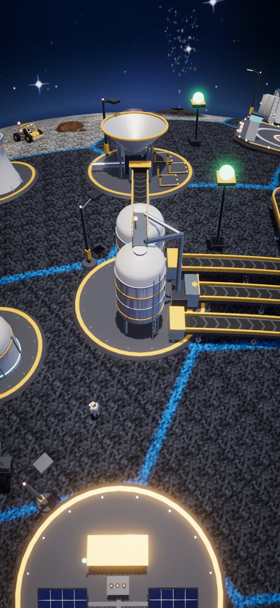

# Lunar Cleanup Tycoon
Clean the planets and automate your factory.

Mobiles 3D-Spiel aus Reinigungssimulation, Idle-Tycoon und Automatisierung: Du wischst die ersten verdreckten Parzellen eines Mondes selbst sauber, dann übernehmen Fahrzeuge, Förderbänder, Pressen, Schmelzen und Drohnen. Verkauft wird per Rakete, Lieferschiffe und Besucher landen auf dem eigenen Landeplatz – und das über 18 Welten vom Mond bis zum Pulsarplaneten Poltergeist. Die Basis arbeitet auch offline weiter.

**Im Browser spielen (Beta):** https://ghostofabian.github.io/Lunar-Cleanup-Tycoon/play-unity/
**Webseite mit Screenshots:** https://ghostofabian.github.io/Lunar-Cleanup-Tycoon/

## Was drin ist
- **18 Planeten** mit eigener Basis, eigenem Wetter, Tag und Nacht und eigener Produktionslinie.
- **9 Fahrzeugtypen** vom Staubi bis zum Kryo-Koloss, dazu Drohnen, Bohrtürme und Erzbagger.
- **Fabrik-Planer:** Gebäude und Förderbänder werden je Planet so gelegt, dass sich nichts kreuzt – mit runden Kurven und Y-Weichen.
- **Landeplatz:** Lieferschiffe bringen Waren von anderen Planeten, Besucher holen ihre Bestellungen ab.
- **Produktions-Ampel** zeigt Engpässe mit passenden Upgrades; im Endausbau bleibt sie grün.
- **Terraforming** bis zum Wald, **Puzzle und Geschichten** auf jedem Planeten, **Medaillenbuch** mit Bestzeiten, **Sternenstaub-Werkstatt** und Neustart.
- **Hard Mode** mit eigenem Spielstand: keine Fahrzeuge, sechs Klassen, Perks zum Finden.
- **Fairer Shop** ohne Werbung und ohne Pay-to-Win (Käufe noch nicht freigeschaltet).

## Stand
- Version 0.5 (Beta), Build 73. Unity 6 (6000.6), Ziel iOS und später Android; die Browser-Version ist ein WebGL-Build desselben Projekts.
- Unity-Projekt: [`unity/`](unity/). Der alte Browser-Prototyp (three.js) liegt in [`prototype/`](prototype/) und wird nicht mehr weiterentwickelt.
- Alle 3D-Modelle entstehen prozedural mit [`unity/Modelle_Quelle/lunar_models.py`](unity/Modelle_Quelle/lunar_models.py) – keine gekauften Assets.

## Für Entwicklung mit Claude Code
- [`CLAUDE.md`](CLAUDE.md) – Projektregeln
- [`docs/PROGRESS.md`](docs/PROGRESS.md) – Stand und nächste Schritte (Build für Build)
- [`docs/DECISIONS.md`](docs/DECISIONS.md) – getroffene Entscheidungen
- [`docs/GAME_SPEC.md`](docs/GAME_SPEC.md) – Spezifikation aus der Prototyp-Zeit
- [`docs/FABRIK_PLANER.md`](docs/FABRIK_PLANER.md) – wie Gebäude und Bänder geplant werden
- [`docs/APPSTORE.md`](docs/APPSTORE.md) – Vorbereitung für App Store und TestFlight
- [`docs/CONVERSATION.md`](docs/CONVERSATION.md) – Verlauf von Wünschen und Feedback
