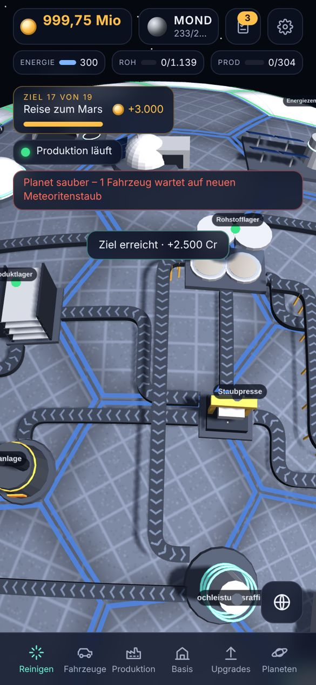

# Lunar Cleanup Tycoon
Clean the planets and automate your factory.

Mobiles 3D-Spiel aus Reinigungssimulation, Idle-Tycoon und Automatisierung: Wische verschmutzte Parzellen eines Mondes sauber, baue Fahrzeuge, Förderbänder, Pressen, Schmelzen, Drohnen und Außenlager auf, verkaufe per Rakete – und arbeite dich über 10 Planeten bis zum Pluto vor. Die Automatik arbeitet auch offline weiter.

Webseite mit Screenshots: `index.html` (über GitHub Pages: https://ghostofabian.github.io/Lunar-Cleanup-Tycoon/ – einmalig unter Settings → Pages „Deploy from a branch“, `main`, `/ (root)` aktivieren).

## Spielen (Browser-Prototyp)
`prototype/index.html` im Browser öffnen (Handy oder Desktop). Der Spielstand wird im Browser gespeichert. Details: [`prototype/README.md`](prototype/README.md).

## Für Entwicklung mit Claude Code
- [`CLAUDE.md`](CLAUDE.md) – Projektregeln
- [`docs/GAME_SPEC.md`](docs/GAME_SPEC.md) – vollständige Spezifikation (Stand Prototyp v3.6)
- [`docs/PROGRESS.md`](docs/PROGRESS.md) – Stand und nächste Schritte
- [`docs/DECISIONS.md`](docs/DECISIONS.md) – Entscheidungen
- [`docs/CONVERSATION.md`](docs/CONVERSATION.md) – Verlauf von Wünschen und Feedback
- [`docs/START_PROMPT.md`](docs/START_PROMPT.md) – Startprompts

Geplant: Umsetzung in Unity 6 (Android/iOS) auf Basis des Prototyps.
